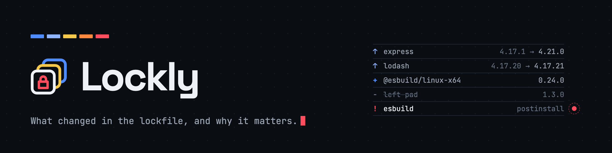
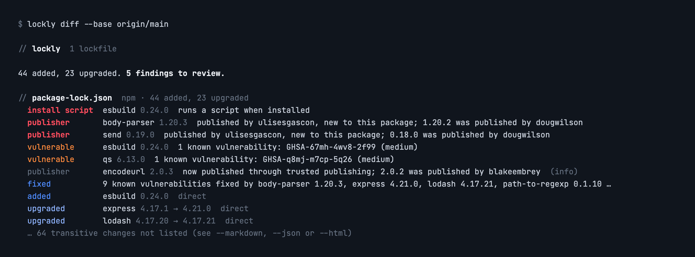
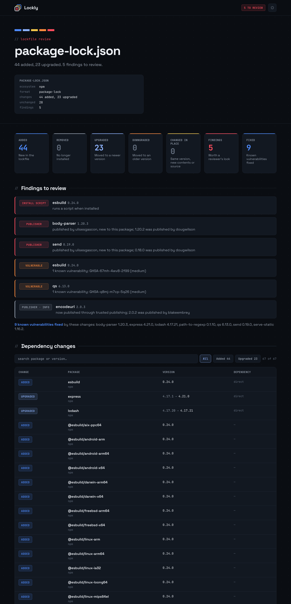

[](https://github.com/fullstackspectrum/lockly)

[](https://github.com/fullstackspectrum/lockly/actions/workflows/build.yml)
[](https://pypi.org/project/lockly/)
[](https://pypi.org/project/lockly/)
[](https://github.com/fullstackspectrum/lockly/blob/main/LICENSE)

# Lockly

**What changed in the lockfile, and why it matters.**

A dependency bump can change a few lines of `package.json` and thousands of lines of `package-lock.json`. Nobody reviews the second part. Lockly does: it reads the lockfile before and after a change, lists what moved, and flags the changes a reviewer should actually stop for:

- **Install scripts:** a package that now runs code when it's installed, the most common route for npm malware.
- **A new publisher:** a release published by an account new to the package, or no longer through trusted publishing. That's what an account takeover looks like.
- **Lost provenance:** the release before had a provenance attestation, this one doesn't.
- **Fresh releases and packages:** a version published in the last few days, or a package that's only weeks old. Most malicious releases are caught and pulled within days.
- **Changed contents or sources:** the same version with a different hash, or a package suddenly coming from git, a URL or another registry.
- **Known vulnerabilities** in the new versions, from [OSV](https://osv.dev), and the ones an upgrade fixes.
- **Deprecations, yanks and licence changes**, including new copyleft terms.

It reads **npm, Yarn (classic and Berry), pnpm, uv, Poetry, Pipenv, Go modules and Cargo** lockfiles, and runs on every pull request as a single comment that updates in place.

Lockly has no runtime dependencies and needs Python 3.11 or later.

> Lockly is a sibling of [Vulnly](https://github.com/fullstackspectrum/Vulnly), [Sbomly](https://github.com/fullstackspectrum/sbomly) and [Basely](https://github.com/fullstackspectrum/basely), and part of [Full-Stack-Spectrum](https://fullstackspectrum.com/): small open-source tools that turn noisy supply chain data into decisions.



## On every pull request

```yaml
name: Lockfile review
on: pull_request

permissions:
  contents: read
  pull-requests: write   # to post the comment

jobs:
  lockly:
    runs-on: ubuntu-latest
    steps:
      - uses: actions/checkout@v4
      - uses: fullstackspectrum/lockly@v0
        with:
          fail-on: install-script,publisher,hash
```

The Action compares the pull request with its base, posts the review as one comment, and edits that comment on every push instead of adding new ones. It also writes the review to the job summary. Pull requests from forks get a read-only token, so there the comment is skipped with a warning and the job summary still has everything.

| Input | Default | |
| --- | --- | --- |
| `fail-on` | | finding types that fail the check (see below) |
| `base` | the PR's base commit | git ref to compare against |
| `paths` | whole repository | space-separated paths to look for lockfiles in |
| `offline` | `false` | `true` skips registry and OSV lookups |
| `min-age` | `3` | flag versions published less than this many days ago |
| `comment` | `true` | post the PR comment |
| `html`, `markdown`, `json` | `lockly-*` | where to write the reports, e.g. for an artifact upload |

## Install

```bash
pipx install lockly     # or: pip install lockly
brew install fullstackspectrum/lockly/lockly
```

There's also a container image for comparing two lockfile files. It has no git, so for `--base` use pip, Homebrew or the Action:

```bash
docker run --rm -t -v "$PWD:/data" fullstackspectrum/lockly diff old/package-lock.json package-lock.json
```

## Usage

Compare every lockfile changed on your branch:

```bash
lockly diff --base origin/main
```

Lockly compares against the merge base, as a pull request does, so changes that landed on `main` since you branched don't show up. Without `--head` it reads the working tree, including lockfiles you haven't committed yet.

Or compare two files:

```bash
lockly diff old/uv.lock uv.lock
```

Write reports, and gate CI:

```bash
lockly diff --base main --markdown comment.md --html report.html --json review.json
lockly diff --base main --fail-on install-script,publisher,hash
```



## Lockfiles

| File | Ecosystem | Notes |
| --- | --- | --- |
| `package-lock.json`, `npm-shrinkwrap.json` | npm | lockfile v1 to v3; records licences and install scripts |
| `yarn.lock` | npm | Yarn classic and Berry; reads `package.json` to tell direct dependencies |
| `pnpm-lock.yaml` | npm | pnpm 5.4 to 9 (pnpm 10's two-document files too) |
| `uv.lock` | PyPI | records upload times, so release age needs no lookup |
| `poetry.lock` | PyPI | reads `pyproject.toml` to tell direct dependencies |
| `Pipfile.lock` | PyPI | reads `Pipfile` to tell direct dependencies |
| `go.mod` | Go | Go's lockfile in effect since 1.17; reads `go.sum` for hashes and follows `replace` directives |
| `Cargo.lock` | crates.io | |

## Findings

| Type | Flags | Needs lookups |
| --- | --- | --- |
| `hash` | same version, different contents (compared only within one hash algorithm) | |
| `install-script` | a package that runs a script at install time, new or newly | npm lockfiles record it; other npm formats look it up |
| `publisher` | a release by an account new to the package, or that left trusted publishing | npm, crates.io |
| `provenance` | the previous release had a provenance attestation; this one doesn't | npm |
| `source` | a package from git, a URL, a path or another registry, or a changed source | |
| `new-package` | an added package first published less than `--new-package-days` (30) ago | yes |
| `young` | a version published less than `--min-age` (3) days ago | yes, except uv |
| `vulnerable` | the new version has known vulnerabilities | OSV |
| `deprecated` | deprecated (npm) or yanked (PyPI, crates.io) | yes |
| `copyleft` | a licence that brings in copyleft terms | npm lockfiles have licences; others look them up |
| `license` | a licence changed between copyleft and permissive terms (other changes are shown as info) | as above |

Publisher findings compare a release with **the release just before it in the registry**, not with whatever version you were on. A maintainer of the previous release taking a turn isn't flagged; an account new to the package is. Moving to trusted publishing is shown as information, since it's an improvement.

`--fail-on` takes any of these, or `any`. Exit codes: `0` passed, `1` a `--fail-on` type was found, `2` bad usage, or a lockfile or git ref that can't be read.

## Network use

**By default Lockly looks things up**: the npm registry, PyPI, crates.io, the Go module proxy and OSV, for the packages that changed and nothing else. Responses are cached for a day in `~/.cache/lockly` (or `$LOCKLY_CACHE_DIR`), each request gives up after 5 seconds without a response, and crates.io's limit of one request a second is respected. If a lookup fails, the review still runs and says what it couldn't check.

`--offline` (or `LOCKLY_OFFLINE=1`) makes no requests at all: you get the diff, hashes, install scripts and licences the lockfile records, sources, and uv's release dates. The HTML report itself never makes network requests.

## Development

```bash
uv venv -p 3.14 && uv pip install -e ".[dev]"
.venv/bin/python -m pytest -q                      # offline: no test reaches a registry
.venv/bin/python docs/screenshots/src/render.py    # README screenshots (network, Chrome)
./docs/brand/src/render.sh                         # README banner and social preview
```

## License

Apache-2.0. The embedded Space Grotesk and JetBrains Mono fonts are under the SIL Open Font License 1.1; their licence files are in `lockly/assets/`. The CVSS 4.0 scoring tables are from FIRST's reference calculator (BSD-2-Clause), credited in `lockly/cvss4_data.py`.
