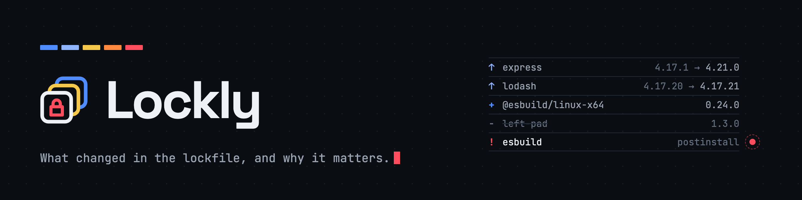
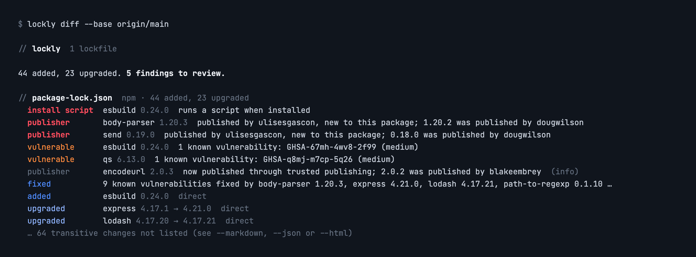
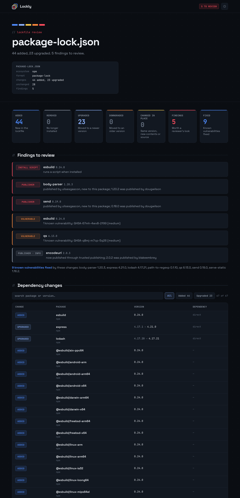

[](https://github.com/fullstackspectrum/lockly)

[](https://github.com/fullstackspectrum/lockly/actions/workflows/build.yml)
[](https://hub.docker.com/r/fullstackspectrum/lockly)
[](https://hub.docker.com/r/fullstackspectrum/lockly/tags)
[](https://github.com/fullstackspectrum/lockly/blob/main/LICENSE)

# Lockly

**What changed in the lockfile, and why it matters.**

A dependency bump can change a few lines of `package.json` and thousands of lines of `package-lock.json`. Nobody reviews the second part. Lockly does: it reads the lockfile before and after a change, lists what moved, and flags the changes a reviewer should actually stop for:

- **Install scripts:** a package that now runs code when it's installed, the most common route for npm malware.
- **A new publisher:** a release published by an account new to the package, or no longer through trusted publishing. That's what an account takeover looks like.
- **Lost provenance:** the release before had a provenance attestation, this one doesn't.
- **Fresh releases and packages:** a version published in the last few days, or a package that's only weeks old. Most malicious releases are caught and pulled within days.
- **Changed contents or sources:** the same version with a different hash, or a package suddenly coming from git, a URL or another registry.
- **Known vulnerabilities** in the new versions, from [OSV](https://osv.dev), and the ones an upgrade fixes.
- **Deprecations, yanks and licence changes**, including new copyleft terms.

It reads **npm, Yarn (classic and Berry), pnpm, uv, Poetry, Pipenv, Go modules and Cargo** lockfiles.

Source, docs and issues: https://github.com/fullstackspectrum/lockly

> Lockly is a sibling of [Vulnly](https://github.com/fullstackspectrum/Vulnly), [Sbomly](https://github.com/fullstackspectrum/sbomly) and [Basely](https://github.com/fullstackspectrum/basely), and part of [Full-Stack-Spectrum](https://fullstackspectrum.com/): small open-source tools that turn noisy supply chain data into decisions.



## Quick start

The image has no git, so you give it two lockfiles. Save the old one from your main branch into a folder of its own, keeping its file name so Lockly can tell the type, then compare:

```bash
mkdir -p .lockly-base
git show origin/main:package-lock.json > .lockly-base/package-lock.json

docker run --rm -t -v "$PWD:/data" fullstackspectrum/lockly \
  diff .lockly-base/package-lock.json package-lock.json
```

Paths are relative to the mounted directory. The `-t` flag gives you colour in the terminal. Drop it in CI logs.

## Reports

Write any mix of reports into the mounted directory:

```bash
docker run --rm -v "$PWD:/data" fullstackspectrum/lockly \
  diff .lockly-base/uv.lock uv.lock \
  --html report.html --markdown comment.md --json review.json
```

- `--html`: a self-contained report that works offline
- `--markdown`: sized for a pull request comment
- `--json`: everything, for your own tooling



## Gate CI

`--fail-on` exits 1 when any listed finding type occurs:

```bash
docker run --rm -v "$PWD:/data" fullstackspectrum/lockly \
  diff .lockly-base/Cargo.lock Cargo.lock \
  --fail-on install-script,publisher,hash
```

| Type | Flags | Needs lookups |
| --- | --- | --- |
| `hash` | same version, different contents (compared only within one hash algorithm) | |
| `install-script` | a package that runs a script at install time, new or newly | npm lockfiles record it; other npm formats look it up |
| `publisher` | a release by an account new to the package, or that left trusted publishing | npm, crates.io |
| `provenance` | the previous release had a provenance attestation; this one doesn't | npm |
| `source` | a package from git, a URL, a path or another registry, or a changed source | |
| `new-package` | an added package first published less than `--new-package-days` (30) ago | yes |
| `young` | a version published less than `--min-age` (3) days ago | yes, except uv |
| `vulnerable` | the new version has known vulnerabilities | OSV |
| `deprecated` | deprecated (npm) or yanked (PyPI, crates.io) | yes |
| `copyleft` | a licence that brings in copyleft terms | npm lockfiles have licences; others look them up |
| `license` | a licence changed between copyleft and permissive terms (other changes are shown as info) | as above |

`--fail-on` takes any of these, or `any`. Exit codes: `0` passed, `1` a `--fail-on` type was found, `2` bad usage or a lockfile that can't be read. Run `docker run --rm fullstackspectrum/lockly diff --help` for every option.

## Other ways to run it

To compare every lockfile changed on a branch in one go (`lockly diff --base origin/main`), or to post a review on every pull request, use pip, Homebrew or the GitHub Action:

```bash
pipx install lockly     # or: pip install lockly
brew install fullstackspectrum/lockly/lockly
```

```yaml
- uses: actions/checkout@v4
- uses: fullstackspectrum/lockly@v0
  with:
    fail-on: install-script,publisher,hash
```

## Network use

**By default Lockly looks things up**: the npm registry, PyPI, crates.io, the Go module proxy and OSV, for the packages that changed and nothing else. In the container, responses are cached in `/tmp/lockly`, so each run starts fresh unless you mount a volume there.

`--offline` (or `-e LOCKLY_OFFLINE=1`) makes no requests at all: you get the diff, hashes, install scripts and licences the lockfile records, sources, and uv's release dates. The HTML report itself never makes network requests.

## Tags

| Tag | Points to |
| --- | --- |
| `latest` | The newest stable release |
| `X` (e.g. `0`) | The newest release in that major series |
| `X.Y` (e.g. `0.1`) | The newest patch release in that minor series |
| `X.Y.Z` (e.g. `0.1.0`) | One exact release |

Every tag is built for `linux/amd64` and `linux/arm64`. Pre-releases are published under their exact version only and never move `latest`.

## Image

Built on Docker Hardened Images' Python 3.14 Alpine runtime: no shell, no package manager, and it runs as the non-root user 65532. Mounted files must be readable by that user, and the directory writable if you write reports.

## License

Apache-2.0. The embedded Space Grotesk and JetBrains Mono fonts are under the SIL Open Font License 1.1, and the CVSS 4.0 scoring tables are from FIRST's reference calculator (BSD-2-Clause); see the [repository](https://github.com/fullstackspectrum/lockly#license) for details.
